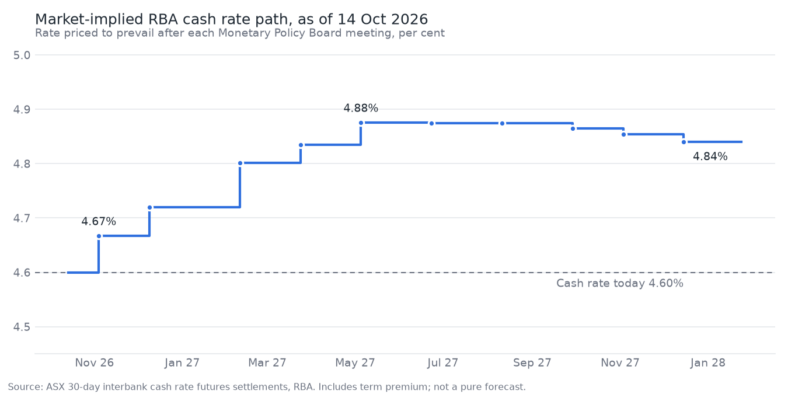

# Latest: 19 October 2026

_Regenerated by every daily update from ASX 24 settlements. Not investment advice._

Cash rate **4.60%** | 3-year futures yield **4.84%** | 10-year **5.25%** | 3s10s **40bp**

## Priced for each meeting

| Meeting | Implied rate | Priced move (bp) | As share of 25bp | Cumulative (bp) |
|---|---|---|---|---|
| 03 Nov 2026 | 4.66% | +5.6 | +22% | +5.6 |
| 08 Dec 2026 | 4.72% | +6.4 | +26% | +12.0 |
| 09 Feb 2027 | 4.78% | +5.9 | +24% | +17.9 |
| 23 Mar 2027 | 4.80% | +2.1 | +8% | +20.0 |
| 04 May 2027 | 4.83% | +3.4 | +14% | +23.4 |
| 22 Jun 2027 | 4.82% | -1.9 | -8% | +21.5 |
| 10 Aug 2027 | 4.80% | -1.5 | -6% | +20.0 |
| 28 Sep 2027 | 4.80% | -0.0 | -0% | +20.0 |
| 02 Nov 2027 | 4.78% | -1.6 | -6% | +18.4 |
| 14 Dec 2027 | 4.76% | -2.4 | -10% | +16.0 |

## Next meeting: model vs market

| Outcome | Model | Model + nowcast | Market |
|---|---|---|---|
| cut | 7% | 10% | 0% |
| hold | 78% | 80% | 78% |
| hike | 14% | 10% | 22% |

## Open positions

| trade_id | symbol | direction | contracts | entry_price | mark | move_bp | pnl | status |
|---|---|---|---|---|---|---|---|---|
| 1 | YTZ2026 | SHORT | 7 | 95.095 | 95.155 | -6.0 | -1180.96 | open |
| 2 | IBX2026 | LONG | 10 | 95.36 | 95.35 | -1.0 | -246.58 | open |

Full trade and forecast record: [SCORECARD.md](SCORECARD.md)
