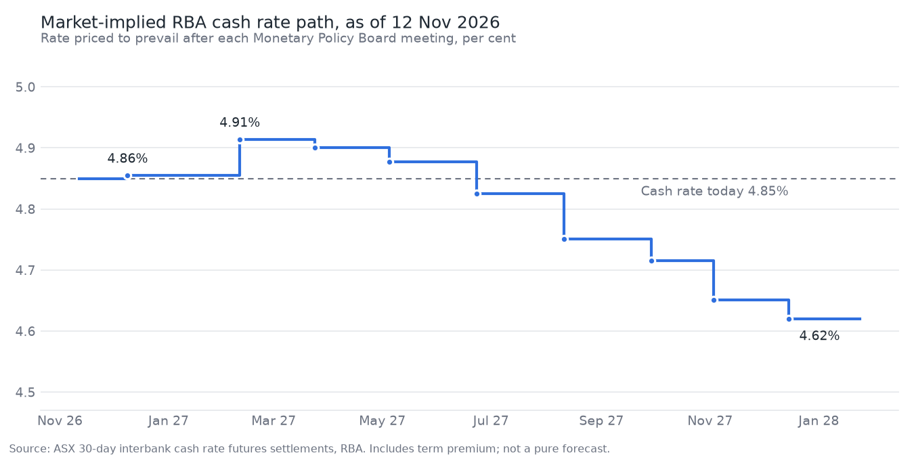

# Latest: 04 November 2026

_Regenerated by every daily update from ASX 24 settlements. Not investment advice._

Cash rate **4.85%** | 3-year futures yield **4.75%** | 10-year **5.09%** | 3s10s **34bp**

## Priced for each meeting

| Meeting | Implied rate | Priced move (bp) | As share of 25bp | Cumulative (bp) |
|---|---|---|---|---|
| 08 Dec 2026 | 4.87% | +2.0 | +8% | +2.0 |
| 09 Feb 2027 | 4.92% | +5.2 | +21% | +7.2 |
| 23 Mar 2027 | 4.92% | +0.3 | +1% | +7.5 |
| 04 May 2027 | 4.91% | -1.1 | -5% | +6.4 |
| 22 Jun 2027 | 4.87% | -4.9 | -19% | +1.5 |
| 10 Aug 2027 | 4.81% | -5.9 | -24% | -4.4 |
| 28 Sep 2027 | 4.78% | -3.1 | -12% | -7.5 |
| 02 Nov 2027 | 4.72% | -5.9 | -24% | -13.4 |
| 14 Dec 2027 | 4.68% | -3.1 | -12% | -16.5 |

## Next meeting: model vs market

| Outcome | Model | Model + nowcast | Market |
|---|---|---|---|
| cut | 7% | 11% | 0% |
| hold | 78% | 79% | 92% |
| hike | 15% | 10% | 8% |

## Open positions

| trade_id | symbol | direction | contracts | entry_price | mark | move_bp | pnl | status |
|---|---|---|---|---|---|---|---|---|
| 1 | YTZ2026 | SHORT | 7 | 95.095 | 95.255 | -16.0 | -3154.48 | open |
| 2 | IBX2026 | LONG | 10 | 95.36 | 95.18 | -18.0 | -4438.36 | STOP HIT |

Full trade and forecast record: [SCORECARD.md](SCORECARD.md)
