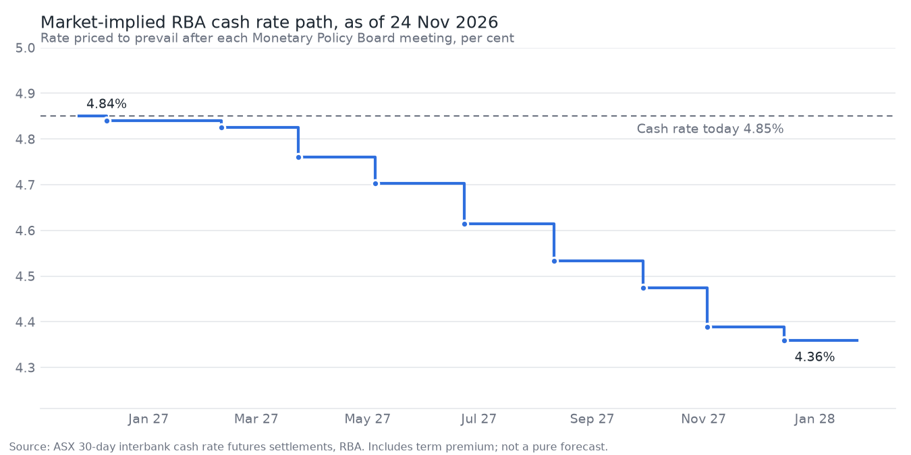

# Latest: 27 November 2026

_Regenerated by every daily update from ASX 24 settlements. Not investment advice._

Cash rate **4.85%** | 3-year futures yield **4.50%** | 10-year **4.84%** | 3s10s **34bp**

## Priced for each meeting

| Meeting | Implied rate | Priced move (bp) | As share of 25bp | Cumulative (bp) |
|---|---|---|---|---|
| 08 Dec 2026 | 4.84% | -0.5 | -2% | -0.5 |
| 09 Feb 2027 | 4.84% | +0.0 | +0% | -0.5 |
| 23 Mar 2027 | 4.80% | -4.0 | -16% | -4.5 |
| 04 May 2027 | 4.74% | -6.9 | -28% | -11.4 |
| 22 Jun 2027 | 4.64% | -9.1 | -36% | -20.5 |
| 10 Aug 2027 | 4.56% | -8.9 | -35% | -29.4 |
| 28 Sep 2027 | 4.47% | -8.1 | -33% | -37.5 |
| 02 Nov 2027 | 4.38% | -9.1 | -36% | -46.6 |
| 14 Dec 2027 | 4.34% | -4.4 | -18% | -51.0 |

## Next meeting: model vs market

| Outcome | Model | Model + nowcast | Market |
|---|---|---|---|
| cut | 7% | 11% | 2% |
| hold | 78% | 79% | 98% |
| hike | 15% | 9% | 0% |

## Open positions

| trade_id | symbol | direction | contracts | entry_price | mark | move_bp | pnl | status |
|---|---|---|---|---|---|---|---|---|
| 1 | YTZ2026 | SHORT | 7 | 95.095 | 95.505 | -41.0 | -8117.2 | STOP HIT |
| 2 | IBX2026 | LONG | 10 | 95.36 | 95.18 | -18.0 | -4438.36 | STOP HIT |

Full trade and forecast record: [SCORECARD.md](SCORECARD.md)
